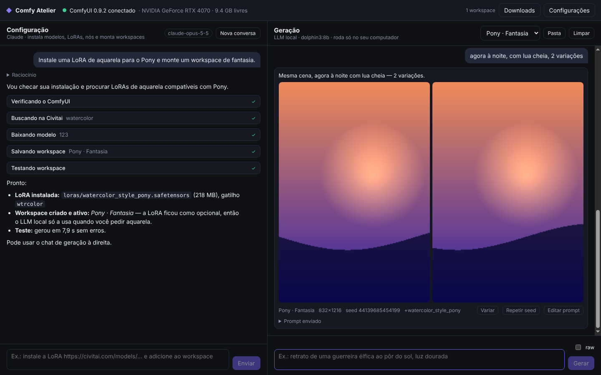

# Comfy Atelier

App desktop (Electron) que fica em cima do [ComfyUI](https://github.com/comfyanonymous/ComfyUI) e substitui a parte chata de instalar, configurar e montar workflows por **dois chats**:

| Chat | Quem responde | Para quê |
|---|---|---|
| **Configuração** (esquerda) | Claude, via API da Anthropic | Instalar checkpoints, LoRAs, VAEs, encoders, custom nodes; preencher metadados (palavras-gatilho, modelo base); criar e testar **workspaces** |
| **Geração** (direita) | Um LLM **local** (Ollama, LM Studio, llama.cpp…) | Você descreve a imagem em linguagem natural, o LLM transforma num prompt otimizado para o modelo do workspace e o app manda para o ComfyUI |



> O screenshot acima foi gerado pelo `npm run smoke`, com servidores falsos de ComfyUI/Ollama e uma conversa de demonstração.

## Como funciona

```
 Você ──► Chat de Configuração ──► Claude (API Anthropic) ──► ferramentas do app
                                                              ├─ Civitai / Hugging Face (busca e download)
                                                              ├─ pasta models/ e custom_nodes/ do ComfyUI
                                                              ├─ comandos (sempre com aprovação)
                                                              └─ workspaces (presets de geração)

 Você ──► Chat de Geração ──► LLM local (Ollama/LM Studio) ──► prompt refinado (JSON)
                                   │                                │
                                   └── nunca sai do seu PC          ▼
                                                     workflow montado pelo app ──► ComfyUI ──► imagens
```

- **Os pedidos de imagem nunca passam pela Anthropic.** O chat de geração fala só com o LLM local e com o ComfyUI. O Claude cuida apenas da configuração e não vê esse chat.
- Um **workspace** é um preset: modelo base (SD1.5, SDXL, Pony, Illustrious, NoobAI, Flux, SD3.5), checkpoint ou trio Flux (unet + encoders + VAE), LoRAs fixas, LoRAs opcionais, sampler/scheduler/steps/CFG/resolução, prefixo e negativo padrão e notas de estilo para o LLM local. O Claude cria e testa os workspaces; você escolhe o ativo no chat de geração.
- O LLM local recebe as regras de prompt da família do modelo (tags danbooru + `score_*` no Pony, tags no Illustrious/NoobAI, linguagem natural no Flux…), as palavras-gatilho das LoRAs e pode **escolher LoRAs opcionais** quando o pedido pede (ex.: "estilo aquarela" ativa a LoRA de aquarela).
- Iteração: "agora à noite", "mais close", "4 variações" — o LLM parte do último prompt. Os botões **Variar** e **Repetir seed** reaproveitam o prompt sem chamar o LLM. `/raw <prompt>` (ou a caixa *raw*) manda o texto direto.

## Requisitos

- **Node.js 22+** (só para rodar/compilar o app)
- **ComfyUI** instalado (portátil do Windows, git + venv, ou ComfyUI Desktop). O Claude também consegue ajudar a instalar via comandos aprovados por você.
- **API key da Anthropic** ([console.anthropic.com](https://console.anthropic.com)) para o chat de configuração.
- **LLM local**: [Ollama](https://ollama.com) ou qualquer servidor compatível com a API da OpenAI (LM Studio, llama.cpp, KoboldCpp, vLLM…). Para conteúdo adulto, use um modelo instruct sem censura (variantes *abliterated*, Dolphin, Hermes…) de 3–12B que caiba na VRAM junto com o ComfyUI.
- Opcional: tokens da **Civitai** (muitos downloads exigem) e do **Hugging Face** (repositórios restritos como o Flux dev).

## Rodando

```bash
npm install
npm run dev          # modo desenvolvimento (hot reload)
```

Gerar instalador:

```bash
npm run dist:win     # .exe (NSIS)
npm run dist:linux   # AppImage
npm run dist:mac     # .dmg
```

### Primeira configuração

1. **Configurações → ComfyUI**: URL do servidor (padrão `http://127.0.0.1:8188`; o ComfyUI Desktop usa `:8000`) e a pasta do ComfyUI (a que tem `main.py`, `models/`, `custom_nodes/`). O app detecta sozinho o Python do pacote portátil (`python_embeded`) ou de um `venv`/`.venv`.
   - Marque *"O app inicia/para o ComfyUI"* se quiser que ele suba o servidor e possa reiniciá-lo depois de instalar custom nodes.
2. **Configurações → Claude**: cole a API key (fica criptografada pelo sistema operacional). Modelo padrão: Claude Opus 5.5; dá para trocar por Sonnet/Haiku para gastar menos.
3. **Configurações → LLM local**: escolha Ollama ou "compatível com OpenAI", clique em *Testar / listar* e selecione o modelo. Com Ollama, `keep_alive = 0` descarrega o LLM logo depois de refinar o prompt, liberando a VRAM para o ComfyUI.
4. **Configurações → Civitai / HF**: tokens opcionais.

### Exemplos de pedidos

Chat de configuração:
- "Verifique minha instalação e me diga o que falta."
- "Instale o Illustrious XL e uma LoRA de aquarela compatível; crie um workspace de anime."
- "Instale https://civitai.com/models/12345 e adicione como LoRA opcional no workspace Pony."
- "Configure o Flux dev em fp8 com tudo que precisa."
- "Tenho vários .safetensors antigos em loras/, identifique cada um na Civitai."

Chat de geração:
- "retrato de uma guerreira élfica num penhasco ao pôr do sol"
- "agora à noite, com lua cheia, 2 variações"
- "/raw 1girl, solo, silver hair, night, full moon"

## Segurança e limites

- Toda ação que muda o sistema passa por um **cartão de aprovação**: apagar modelos, instalar custom nodes, executar comandos. Downloads também, a não ser que você ative *aprovar downloads automaticamente*.
- Caminhos vindos do modelo são validados (nada escapa de `models/`), downloads vão para `.part` e são verificados por **SHA-256** quando a Civitai/HF informa o hash.
- O chat de geração permite conteúdo adulto entre **adultos**. Há duas camadas que não dá para desligar: o system prompt do LLM local proíbe conteúdo sexual com menores ou com pessoas reais identificáveis, e uma verificação determinística no app bloqueia qualquer prompt que combine termos sexuais com indicação de menor de idade, mesmo que o LLM local ignore as regras. Em prompts sexuais o app também acrescenta `child, loli, shota, underage` ao negativo.
- O Claude segue a política de uso da Anthropic; ele instala e configura modelos, mas não escreve prompts explícitos (isso fica com o LLM local).

## Desenvolvimento

```bash
npm test             # vitest: unidades + integração com ComfyUI/Ollama/API da Anthropic falsos
npm run typecheck
npm run build && npm run smoke   # abre o app Electron de verdade contra servidores falsos (Linux: xvfb-run -a npm run smoke)
```

Estrutura:

```
src/
  shared/            tipos, canais IPC, perfis por família de modelo (resoluções, prefixos, guias de prompt)
  main/              processo principal (Node)
    claude/          agente do chat de configuração: loop com streaming, ferramentas, system prompt, transcript
    generation/      chat de geração: cliente do LLM local, refinador de prompt, verificação de segurança, sessão
    comfy/           cliente HTTP/WebSocket do ComfyUI, montagem de workflows, inventário de modelos, processo
    sources/         Civitai, Hugging Face e gerenciador de downloads
    settings.ts      configurações + segredos criptografados (safeStorage)
    workspaces.ts    presets de geração
  preload/           ponte segura (contextIsolation + sandbox) entre main e renderer
  renderer/          interface React (dois chats, configurações, downloads, logs do ComfyUI)
test/                testes (vitest)
scripts/smoke-e2e.mjs
```

Detalhes da integração com o Claude:
- Loop próprio com `client.beta.messages.stream`, *adaptive thinking* (resumo visível em "Raciocínio"), `effort` configurável, cache de prompt automático e *fallback* do lado do servidor (`fallbacks: "default"`) para recusas de classificador.
- O histórico é salvo **literalmente** e só recebe acréscimos (o system prompt e a lista de ferramentas não mudam entre turnos), o que mantém o cache e os blocos de raciocínio válidos.
- As ferramentas usam `eager_input_streaming`, e toda entrada é validada com Zod antes de executar.

## Próximos passos sugeridos

- Galeria com histórico de imagens e metadados (prompt/seed) embutidos no PNG
- img2img / inpainting e upscale (hires fix) como opções do workspace
- Integração com o ComfyUI-Manager para buscar custom nodes pelo nome
- Compactação de contexto para conversas de configuração muito longas
